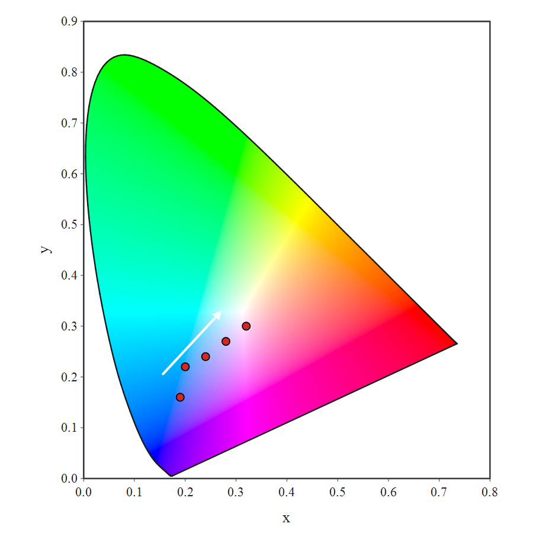

# CIE1931xy 重建版

CIE1931xy 是 Windows 桌面色度分析工具，使用 C# / .NET 8 / WinForms 重建原版 1.6.0.2，并提供 2.0 多光谱工作台。它支持导入光谱、输入色坐标、绘制 CIE 1931 xy / CIE 1976 u'v' 色度图，以及导出图片和结果。

默认打开新版工作台；经典界面通过 `--classic` 或「视图 → 打开经典界面」进入。项目版本为 2.1.0，业务数据只保存在内存中，目前没有工程文件保存功能。

新版工作台更改设置后，会在 **程序所在目录** 自动生成 `./CIE1931xy.settings.json`，下次启动恢复上次设置。配置只保存软件偏好，导入的光谱和坐标数据仍需重新导入。

## 下载软件

公开源码仓库：[lhbacxc/CIE1931xy-V1](https://github.com/lhbacxc/CIE1931xy-V1)。软件在 [GitHub Releases](https://github.com/lhbacxc/CIE1931xy-V1/releases) 提供 Windows x64 下载：

| 下载文件 | 适用情况 |
| --- | --- |
| `CIE1931xy-v2.1.0-win-x64.exe` | 轻量单文件，需要已安装 .NET 8 Desktop Runtime x64 |
| `CIE1931xy-v2.1.0-win-x64-portable.zip` | 推荐普通用户下载；包含运行时，解压后打开 `./CIE1931xy.exe` 即可，无需另装 .NET |
| `SHA256SUMS.txt` | 用于核验上述下载文件的完整性 |

便携版 exe 启用了单文件内部压缩，首次运行会自动解包组件到用户临时目录。请解压到可写目录使用，以便保存程序旁的设置文件；更新时保留 `./CIE1931xy.settings.json`，替换 exe 即可。轻量版缺少运行时时，请从下方微软下载页安装 Desktop Runtime。

## 文档入口

- 使用软件：本文件。
- 接手开发：[项目入门指南](./doc/PROJECT_GUIDE.md)。
- 架构与计算边界：[架构说明](./doc/ARCHITECTURE.md)。
- 环境、命令与验证范围：[开发与验证指南](./doc/DEVELOPMENT.md)。
- 编码代理执行规则：[AGENTS.md](./AGENTS.md)。
- 历史资料：[修订摘录](./doc/CHANGELOG.md)、[合并计划与实施记录](./doc/MERGE_PLAN.md)、[逆向工程记录](./doc/REVERSE_ENGINEERING.md)。历史资料中的旧界面和验收数据不代表当前状态。

## 运行与构建

运行框架依赖版需要 Windows x64 和 **.NET 8 Desktop Runtime**；从源码构建使用 **.NET 10 SDK**，具体版本由 `./global.json` 约束，程序运行目标暂时仍为 .NET 8。

只运行软件时，安装 [.NET 8 下载页](https://dotnet.microsoft.com/en-us/download/dotnet/8.0) 中「.NET Desktop Runtime → Windows → x64」即可；普通 .NET Runtime 或仅安装 .NET 9/10 不能按默认配置替代该依赖，不需要 SDK、Visual Studio、Python 或 Conda。缺少 .NET 时由 exe 内的 .NET 启动器提供安装提示与下载入口，常规 GUI 启动通常会弹窗；当前没有额外的自定义中文环境检查窗口。自包含发布会把运行时一同打包，目标机器无需另外安装 .NET。

当前框架依赖 exe 通过 .NET 启动器定位运行时：优先考虑 DOTNET_ROOT_X64 / DOTNET_ROOT 指定的安装根目录，再使用系统注册的 x64 安装目录或默认的 ProgramFiles 下 dotnet 目录；不依赖 PATH 去全盘查找。选定 .NET 安装根目录后，在其中匹配 .NET 8 的 Core 和 Windows Desktop 框架，不会因为缺少所需版本而继续遍历另一套私人安装目录。用户目录里的 SDK 不会自动替代机器级运行时；标准安装 .NET 8 Desktop Runtime x64 后通常无需设置这些变量。

在项目根目录打开 PowerShell：

```powershell
$ErrorActionPreference = 'Stop'
$OutputEncoding = [Console]::InputEncoding = [Console]::OutputEncoding = New-Object System.Text.UTF8Encoding
$PSDefaultParameterValues['*:Encoding'] = 'UTF8'

.\dist\CIE1931xy.exe                          # 运行已有发布版（如该文件存在）
.\build.ps1                                 # 默认 all：构建 + 双基线 GoldenTests + SelfTest
.\build.ps1 -Target restore                 # 还原解决方案的编译依赖
.\build.ps1 -Target build                   # 只构建源码
.\build.ps1 -Target test                    # 构建测试程序并检查两套 oracle
.\build.ps1 -Target selftest                # 构建主程序并执行渲染/导出自检
.\build.ps1 -Target run                     # 构建并启动源码产物
.\build.ps1 -Target publish                 # 发布框架依赖单文件到 ./dist/
.\build.ps1 -Target publish -SelfContained  # 自包含发布，目标机无需另装运行时
```

脚本会优先寻找用户目录中的 SDK，找不到时可用 `-DotnetPath` 指定 SDK 的 `dotnet.exe`；它会另行寻找 .NET 8 运行时来执行测试和自检。`publish` 先跑回归和自检，再核验并更新 `./dist/` 中的发布产物，保留配置和其他用户文件。`run` 直接启动刚构建的程序，不依赖旧发布版。

本机已补齐用户目录下的 .NET 10.0.404 SDK，并保留现有 .NET 8 Desktop Runtime。解决方案、编辑规范与 VS Code 构建/调试配置已补齐；实际源码构建和验证结果见 [开发指南](./doc/DEVELOPMENT.md)。

## 新版工作台

启动时没有示例数据，也没有「载入示例」按钮。左侧为三个页签：**光谱曲线 / 三刺激值 / 坐标点**，右侧为图形预览。

左侧表格上方按「导入光谱 / 输入数据」和「批量改名」分组；右侧图形上方按「颜色 / 描边」、「添加箭头 / 管理箭头」和「导出数据 / 导出图片」分组。组内间距统一，组间留白较大，窄窗口下整组换行；导出图片为蓝色主按钮。无数据时禁用数据样式与箭头操作，仍可导出空白色度底图。

左下显示设置区按内容和可用空间调整高度；快捷键提示固定在底部，分三行显示。较小窗口下设置项可纵向滚动，底部提示仍保持完整可见。

### 导入与输入

| 入口 | 行为 |
| --- | --- |
| 导入光谱 / `Ctrl+O` | 多选 `.csv/.txt/.dat`，自动识别光谱或坐标文件 |
| 输入数据 / `Ctrl+Shift+V` | 统一窗口，手动输入、从 Excel 粘贴或点击「读取剪贴板」，确认后添加光谱或坐标 |
| 输入色坐标 / `Ctrl+Shift+O` | 打开同一个输入窗口，预选「色坐标」类型 |
| `Ctrl+V` | 在主窗口直接读取剪贴板文本并自动识别 |
| 拖放 / `--open` | 导入文件；启动参数一次指定一个文件 |

光谱支持逗号、分号、Tab、空格、竖线分隔及多条强度列；按波长排序，重复波长取平均，异常数据通过警告或错误反馈。单曲线文件以文件名命名，多曲线文件使用列标签。导入默认红色 `#D62728`、圆形、黑色描边。

「输入数据」默认使用自动识别，也可指定「色坐标」或「光谱」以纠正类型判断。窗口初始为空，读取剪贴板后可编辑文本，点击「添加数据」才导入；取消不添加数据。手动输入、粘贴与快捷键共用添加与样式初始化链路。

坐标常见格式为 `x,y`、`名称,x,y`、`名称,x,y,强度`、`序号,名称,x,y`。解析器对数值列组合打分；检测到 u'/v' 表头时转换为 xy。额外数值列可能造成歧义，导入后应核对坐标。

文件读取支持 UTF-8 BOM、UTF-16 BOM、严格 UTF-8、GBK(936)，最后回退 Latin-1。项目源码和文档仍统一使用 UTF-8。

### 表格与选择

- 光谱曲线页显示名称、形状、颜色、描边；三刺激值页显示波长范围、点数、峰值波长和 X/Y/Z；坐标点页显示独立输入点的 xy、u'v'、CCT 和 Δuv。光谱曲线的完整派生结果可通过 CSV/TXT 查看。
- 双击名称列重命名；右键修改形状、颜色、标签或删除。支持 Ctrl/Shift 多选及 Delete 删除。
- 光谱曲线右键可「隐藏这条曲线 / 显示这条曲线」，菜单标注 `Space` 和 `Delete` 快捷键。光谱表格获得焦点时，按空格键切换选中曲线的隐藏/显示，按 Delete 删除；支持多选，混合显示状态时统一隐藏、全部隐藏时统一显示。隐藏后名称标注「已隐藏」，保留选择，便于再次按空格恢复。
- 隐藏只影响图上的标记、描边、高亮、标签与图例，xy/u'v' 及 PNG/TIFF/SVG 导图同步；光谱原始数据、三刺激值和 CSV/TXT 结果仍保留，名称和样式不变。
- 「颜色 / 描边」应用于选中数据，无选中项时应用于全部数据。批量改名针对曲线和坐标点，可使用 `{n}` 编号；查找留空表示统一改名。
- 点击画布中的点或空白处可选择或取消选择。选中高亮只用于预览，UI 图片导出时会关闭。

### 绘图与计算

| 设置 | 当前行为 |
| --- | --- |
| 图型 | xy / u'v'，`Ctrl+T` 切换 |
| 轴范围 | xy 固定 x=0–0.8、y=0–0.9；u'v' 两轴均 0–0.65，无自动/手动轴范围入口 |
| 坐标轴标题 | 「坐标轴设置」可改横、纵轴名称并分别调整间距（0–80，默认 16）；纵轴标题旋转 90°，名称按图型分别保留，间距共用 |
| 字体与文字大小 | 「字体与字号」可分别选择数字/字母字体和中文字体，默认 Times New Roman / 宋体；坐标轴标题、刻度、波长、数据标签、图例及黑体温度的大小可分别调整（8–64） |
| 预览 | xy 与 u'v' 统一采用可编辑的矢量绘图，不提供位图/矢量背景类型切换；预览方式不限制导出格式 |
| 背景颜色 | 默认纯白；「黑色背景」开启为纯黑、关闭为纯白，预览与导出同步，坐标轴、文字和图例配色随之调整 |
| 黑体线 | 默认开启，实时绘制，`Ctrl+P` 切换 |
| 网格 | 默认开启，两种图型均可开关，切换图型保留设置 |
| 图例 / 波长标注 / 数据标签 | 默认关闭，可独立开关，图例位于右下角 |
| 参考线 | x+y=1，即 z=0；默认隐藏，可通过「参考线」按钮或视图菜单开关，仅适用于 xy，切换图型保留选择 |
| 标题 | 默认不显示 |

新版光谱计算默认逐点求和，对 CIE1931 配色函数线性插值，**不做 Y=100 归一化，也不执行经典算法的四位小数取整**。经典界面保留原版 1nm/5nm 解析、求和和取整语义；两条链路不能混为一谈。

CCT 在 CIE1960 uv 中寻找黑体轨迹最近点。界面字段 Δuv 当前为非负距离，超过 0.05 时标记为仅供参考；它不是带符号的标准 Duv。标准光源选择和积分口径切换尚未提供界面入口。

### 箭头方向标注

从 v2.1.0 起提供箭头方向标注，轻量版与便携版均包含此功能。

1. 先绘制至少两个可见的数据点，点击右上「添加箭头」，或使用「视图 → 添加箭头」。
2. 选择方向参考的起点、终点，列表同时包含光谱计算点和独立坐标点，显示来源、序号、名称及当前图型坐标。
3. 选择直线或弯曲箭头，可改颜色、线宽、弯曲程度与左右朝向，以及描边。默认白色、线宽 2.5、黑色细描边。
4. 添加后箭头放在点列旁边；按住箭身或箭头头部拖动到合适位置，整条箭头平移，方向保持起点 → 终点。直线与参考方向平行，弯曲箭头的形状也随整体平移保持。
5. 「管理箭头」可添加、编辑或删除，双击列表行编辑，Delete 删除所选箭头；点击画布空白处可取消选中高亮。



xy/u'v' 切换后仍使用原来的参考数据点；PNG/TIFF/SVG 导出包含拖动后的箭头，选中高亮只用于预览。改名不改变绑定，隐藏光谱时相关箭头暂时隐藏，恢复后重新显示；删除参考点会一并删除相关箭头，清空数据同时清空箭头。重合点不能创建箭头，点距过近时缩小或省略；拖动只影响标注位置，不改变坐标或计算结果。

箭头与业务数据只保留在当前会话，不写入软件偏好配置或 CSV/TXT；关闭后需要重新导入数据并添加箭头。

### 导出

| 格式 | 内容 |
| --- | --- |
| PNG / TIFF | UI 固定 1400×1400 px，DPI 默认 300，可选 72–1200；DPI 只改变元数据，不增加像素 |
| SVG | 文字、线条和标记为矢量，背景使用连续横向渐变及平滑轮廓裁剪，不内嵌 PNG 位图 |
| CSV | UTF-8 BOM，每条曲线和独立坐标点一行，含色度、峰值、CCT 等字段 |
| TXT | UTF-8 BOM，计算结果与公式说明；其中「1nm 采样」文字不能替代实际输入步长 |

不提供 PDF 导出。导出文件名随配置保存，下次打开图片导出时按文件扩展名选择 PNG/TIFF/SVG。坐标点 CSV 中的 XYZ 由 xy 在 Y=1 假设下反推，并非测得的三刺激值。

图片保存完成后会弹出「导出成功」提示框，显示完整保存位置，点击「确定」关闭；PNG、TIFF、SVG 均适用，状态栏信息仍保留。取消保存不弹出成功提示，写入失败只显示错误提示。

**导出无网格图片**：关闭「网格」→ 点击「导出图片」，保存为 PNG、TIFF 或 SVG。新版统一采用矢量绘图，使网格和标注可以独立控制；界面已有相应说明，导出时仍可选择位图或矢量图格式。

**隐藏浅灰斜参考线**：「显示设置」中的「参考线」控制 x+y=1（z=0）线，预览与 PNG/TIFF/SVG 导出同步；色域的黑色边界不受影响。它来自色度坐标 x+y+z=1，不是单独计算的切线，也不是色域下方的紫线。

**修改坐标轴标题与位置**：点击「显示设置 → 坐标轴设置」，输入横、纵轴名称并调整各自间距，再点击「应用」。间距越大，标题与刻度文字的距离越大；名称留空使用当前图型默认名称（x/y 或 u'/v'），「恢复默认」还原当前图型名称和间距。纵轴标题沿轴方向排列；标题与刻度先测量后布局，长标题按可用空间缩小字号。设置作用于当前预览及 PNG/TIFF/SVG 导出，不改变坐标数值或计算结果。

**修改图中文字的字体与大小**：点击「显示设置 → 字体与字号」，或「视图 → 字体与字号」。数字、英文字母和科学符号默认 Times New Roman，汉字及中文标点默认宋体，中英文混排会分别使用对应字体。窗口提供混排示例，以及六类文字的大小设置；点击「应用」生效，「取消」不保存本次修改，「恢复默认」后再应用可还原字体与大小。设置对 xy/u'v' 共用，预览与 PNG/TIFF/SVG 导出同步；文字随画布大小缩放，长标题、过宽的数据标签和图例会适应可用空间。设置自动写入程序旁的配置文件，重启后恢复；SVG 引用字体名称，不嵌入字体文件。

**自动保存设置**：图型、黑白背景、网格/黑体/参考线/波长/图例/标签开关、中英文字体及六类文字大小、xy/u'v' 的轴标题及间距、导出 DPI 和文件名均会保存。首次更改后生成 `./CIE1931xy.settings.json`，连续更改会合并保存，立即关闭也会补存；启动时读取同目录文件。关闭软件后删除该文件可恢复默认。配置损坏时使用默认设置并在状态栏提示，不会在启动时覆盖原文件；程序目录无法写入时也会提示。文件位置取决于实际运行的 exe：发布版在 `./dist/`，源码构建版在对应的 `./src/CIE1931xy.Rebuilt/bin/` 子目录。经典模式和 `--selftest` 不读写这份配置。

**切换黑白背景**：点击「显示设置 → 黑色背景」，或使用视图菜单的同名开关。色域外的画布背景在纯白与纯黑之间切换，色域本身的颜色保留；xy/u'v' 均可使用，PNG/TIFF/SVG 导出采用当前背景颜色。

## 经典界面与命令行

```powershell
$ErrorActionPreference = 'Stop'
$OutputEncoding = [Console]::InputEncoding = [Console]::OutputEncoding = New-Object System.Text.UTF8Encoding
$PSDefaultParameterValues['*:Encoding'] = 'UTF8'

.\dist\CIE1931xy.exe --classic
.\dist\CIE1931xy.exe --classic --no-blackbody
.\dist\CIE1931xy.exe --classic --planckian
.\dist\CIE1931xy.exe --open .\tests\oracle\case_bb_5nm_380_780.txt
.\dist\CIE1931xy.exe --selftest .\.codegraph\validation\selftest
```

经典界面先输入「波长、强度」两列，选择 1nm 或 5nm 间隔，再 Calculate；Draw Point 描点，Clr Input / Clr Rec / Clr Point 清理对应内容，Exp Graph 导图，Chinese 切换语言，双击 Data Input 标签从 TXT 导入。

经典模式 `Ctrl+B` 更换底图，`Ctrl+P` 切换计算黑体叠加层。`--blackbody` / `--no-blackbody` 选择底图，`--planckian` 开启计算叠加层；旧 README 提到的 `--no-planckian` 没有实现。`--selftest` 不打开主窗口，省略目录时写入系统临时目录。

经典模式按 DpiUnaware 运行，新版按 PerMonitorV2 运行。从工作台打开经典界面优先启动独立进程，两者 DPI 策略分别维护。

## 源码来源与致谢

本项目基于 [chenhunquan](https://github.com/chenhunquan) 提供的源码开发，在此基础上优化了绘图交互、数据管理与图片导出，并新增箭头方向标注等功能。感谢 chenhunquan 分享源码与相关实现。

本项目同时保留了历史 CIE1931xy 原程序的经典界面与计算语义。原程序作者为 nicklxg，原程序版权归原作者；原版署名、兼容性验证及逆向过程详见 [逆向工程记录](./doc/REVERSE_ENGINEERING.md)。
