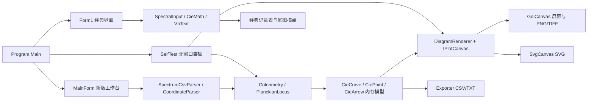

# 项目入门指南：CIE1931xy

本工具把光谱数据转成 XYZ、xy、u'v'、峰值和 CCT 等结果，再绘制色度图、导出图片与数据。它是一套 Windows 桌面单体程序：新版工作台负责多数据管理，经典界面保留原版 1.6.0.2 的交互与计算语义，没有服务器或数据库。

本文中的代码路径相对项目根目录。先看 [使用说明](../README.md)，执行任务前看 [项目指令](../AGENTS.md)；细节分别放在 [架构说明](./ARCHITECTURE.md) 和 [开发与验证指南](./DEVELOPMENT.md)。

## 技术栈

| 部分 | 技术与约束 |
| --- | --- |
| 主程序 | C#、.NET 8、WinForms、System.Drawing/GDI+，仅 Windows |
| 配置 | net8.0-windows，LangVersion=latest，Nullable/ImplicitUsings 关闭，版本 2.1.0 |
| 依赖 | 仅框架依赖；两个 csproj 都没有第三方 PackageReference |
| 构建 | global.json 约束 .NET 10 SDK + PowerShell `./build.ps1`，可发布 win-x64 单文件 |
| 测试 | net8.0 自定义 GoldenTests 控制台程序 + 主程序 `--selftest` |
| 外部服务 | 无网络服务、数据库、ORM；业务数据存于当前进程内存 |

## 架构与数据流



典型任务：文件、拖放或粘贴进入 `MainForm`，先识别光谱/坐标，再解析和计算，存入 `_curves` / `_points`；表格同步模型，140ms Timer 合并重绘请求。预览与图片导出共用渲染器，CSV/TXT 直接读取模型；没有 HTTP 请求链路。

新版软件偏好独立保存到程序旁的 `./CIE1931xy.settings.json`：400ms 合并连续更改，关闭前补存，启动时恢复；不保存光谱/坐标数据。源码构建与发布版各自按实际运行目录读取配置，经典及自检入口不读写。配置和用户文件会在发布更新时保留。

## 目录职责与关键入口

| 相对路径 | 职责 |
| --- | --- |
| `./src/CIE1931xy.Rebuilt/Program.cs` | CLI 参数、编码提供程序、DPI 策略、界面/自检入口 |
| `./src/CIE1931xy.Rebuilt/MainForm.cs` | 新版布局、三页签、导入、选择、批量改名、样式及导出交互 |
| `./src/CIE1931xy.Rebuilt/MainForm.FontSettings.cs` | 新版中英文字体、六类文字大小、混排预览及恢复默认交互 |
| `./src/CIE1931xy.Rebuilt/MainForm.Arrows.cs`、`MainForm.ArrowDragging.cs`、`UI/ArrowEditorDialog.cs` | 点列旁的方向箭头、端点选择、编辑/删除、整体拖动及示意预览 |
| `./src/CIE1931xy.Rebuilt/Core/ArrowModel.cs`、`Core/Rendering/ArrowGeometry.cs`、`ArrowRenderer.cs` | 参考点绑定、相对位置偏移与 GDI/SVG 共用的箭头几何/裁剪 |
| `./src/CIE1931xy.Rebuilt/MainForm.Settings.cs`、`./src/CIE1931xy.Rebuilt/Core/AppSettings.cs`、`./src/CIE1931xy.Rebuilt/Core/SettingsStore.cs` | 配置白名单、启动恢复、变更保存及 UTF-8 JSON 完整写入后替换 |
| `./src/CIE1931xy.Rebuilt/UI/` | 新版控件的小圆角绘制，保留 WinForms 原生交互与自动尺寸 |
| `./src/CIE1931xy.Rebuilt/Form1.cs`、`Form1.Designer.cs` | 经典事件逻辑与控件布局 |
| `./src/CIE1931xy.Rebuilt/Core/` | 输入解析、模型、两条计算链路、CMF 表、黑体物理与资源加载 |
| `./src/CIE1931xy.Rebuilt/Core/Rendering/` | 图型坐标、真彩背景、GDI/SVG 画布与共享渲染器 |
| `./src/CIE1931xy.Rebuilt/Core/Export/Exporter.cs` | PNG/TIFF/SVG/CSV/TXT 导出 |
| `./src/CIE1931xy.Rebuilt/Resources/` | 两张 684×732 原版底图与图标，编译时嵌入 |
| `./tests/GoldenTests/`、`./tests/oracle/` | 经典回归程序、两套 JSON 基线与输入数据 |
| `./doc/`、`./doc/screens/` | 当前开发文档、历史工程记录与历史截图 |
| `./dist/`、工程下 `bin/obj/` | 发布/构建产物；程序目录也可能生成个人配置，发布不清空 dist |
| `./.codegraph/` | 本机 C# 符号、调用与依赖索引，不提交数据库 |

## 最先掌握的边界

- 经典 `CieMath` 处理 1nm/5nm，使用 VB 兼容取整和 G15 文本格式；新版 `Colorimetry` 支持 CMF 插值，默认逐点求和、不归一、不做经典四位取整。
- 梯形积分与可选 Y=100 归一函数存在，但默认计算链路及 UI 没有调用它，也没有标准光源选择入口。
- 新版工作台的 xy/u'v' 统一使用矢量绘图，已移除位图/矢量背景切换及新版 Ctrl+B；UI 范围固定。经典底图与底层兼容分支的位图 xy 仍须按底图自身轴矩形映射。
- UI 导图是 1400×1400 px，DPI 仅为元数据；自检导图是 900×900 px。新版可导出 PNG/TIFF，SVG 不内嵌 PNG；底层自检仍覆盖可内嵌 PNG 的位图兼容分支。
- GoldenTests 不覆盖新版完整流程，也不验证 UI 像素；箭头自检包含 PNG/TIFF/SVG 的内容、尺寸/DPI 与边界检查，仍不能替代完整 UI 或视觉验收。

## 项目约定与常见任务

类型和方法一般用 PascalCase，私有字段多以下划线开头；文件级/块级 namespace 并存，修改时沿用局部风格。新版解析器返回成功项、Warnings、Errors，UI 捕获文件级异常并反馈状态；经典算法使用 Status/ParseFailure。

在根目录 PowerShell 初始化编码后执行：

```powershell
$ErrorActionPreference = 'Stop'
$OutputEncoding = [Console]::InputEncoding = [Console]::OutputEncoding = New-Object System.Text.UTF8Encoding
$PSDefaultParameterValues['*:Encoding'] = 'UTF8'

codegraph status .
.\build.ps1 -Target build
.\build.ps1 -Target test
```

默认 build.ps1 包含主程序构建、两套 oracle 和 SelfTest；完整命令见开发指南。`./CIE1931xy.sln` 包含两个工程，`./.vscode/` 提供 Debug 构建与新版/经典调试配置，`./.editorconfig` 统一 UTF-8 和缩进。源码修改后同步 CodeGraph。本地 main 对应公开仓库 [lhbacxc/CIE1931xy-V1](https://github.com/lhbacxc/CIE1931xy-V1)，提交说明默认中文；没有覆盖率或 CI 入口。Release 提供轻量版与自带运行时的便携版，发布命令、版本管理与忽略范围见开发指南。

2026-11-19 已补齐用户目录下的 .NET 10.0.404 SDK；主程序目标仍为 .NET 8。当前验证结果与此前的二进制检查分别记录在开发指南。

## 修改位置索引

| 想修改的内容 | 优先定位 |
| --- | --- |
| 光谱编码、分隔符、多列或重复波长 | `Core/SpectrumCsvParser.cs`：ReadTextFile、Parse |
| xy/u'v' 输入与列识别 | `Core/CoordinateParser.cs`：Parse、PickColumns |
| 新版积分、坐标转换、CCT | `Core/Colorimetry.cs`：AnalyzeCurve、SpectrumToXyz、CorrelatedColorTemperature |
| 经典算法兼容 | `Core/SpectralInput.cs`、`Core/CieMath.cs`、`Core/VbText.cs`；配套 GoldenTests |
| 黑体公式与经典叠加样式 | `Core/PlanckianLocus.cs`、`Core/PlanckianOverlay.cs` |
| 图层、标记、图例、字号与坐标映射 | `Core/Rendering/DiagramRenderer.cs`、`PlotSpace.cs` |
| 图中文字字体、混排及测量 | `MainForm.FontSettings.cs`、`Core/Rendering/PlotTextLayout.cs`、`GdiCanvas.cs`、`SvgCanvas.cs` |
| 真彩色域与 SVG 渐变、裁剪 | `Core/Rendering/ChromaBackground.cs`、`SvgCanvas.cs` |
| 导出字段、DPI 与像素尺寸 | `Core/Export/Exporter.cs` 和 `MainForm` 的 ExportImage/ExportWidth/ExportHeight |
| 新版布局、交互、选择 | `MainForm.cs`：BuildUi、BuildActionBar、CanvasMouseClick、BatchRename |
| 箭头添加、管理、拖动与方向几何 | `MainForm.Arrows.cs`、`MainForm.ArrowDragging.cs`、`UI/ArrowEditorDialog.cs`、`Core/Rendering/ArrowGeometry.cs` / `ArrowRenderer.cs` |
| 坐标轴标题、间距与留白 | `MainForm.cs`：EditAxisTitles；`Core/Rendering/DiagramRenderer.cs`：MeasureAxisLayout、DrawAxisTitles |
| 黑白画布背景与文字对比 | `MainForm.cs`：OnStyleChanged；`Core/Rendering/DiagramRenderer.cs`：SetBlackBackground、LabelColor、DrawLegend |
| 经典布局、双语文本 | `Form1.cs`、`Form1.Designer.cs`、`Core/CieData.cs` |
| 构建、资源嵌入、版本 | `./build.ps1` 与主工程 csproj |

表中 Core/、Form1、MainForm 等源码路径相对 `./src/CIE1931xy.Rebuilt/`。
